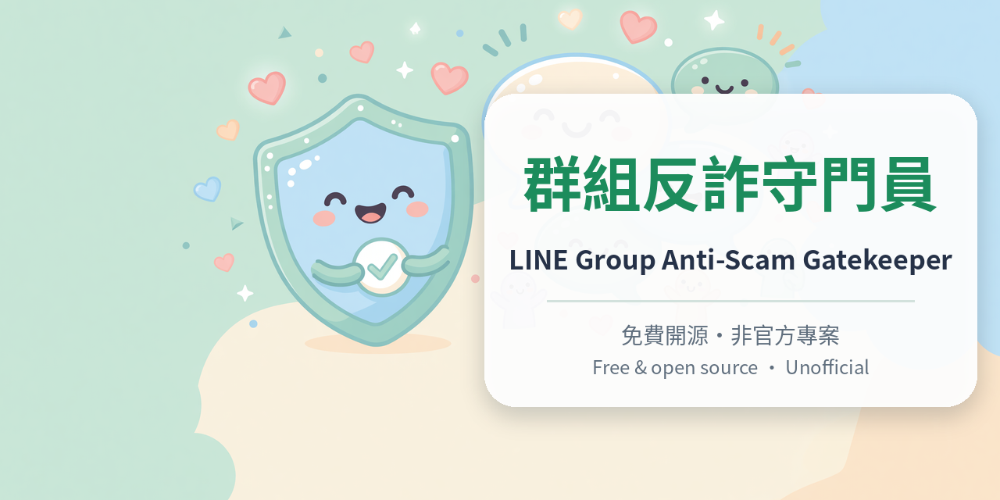
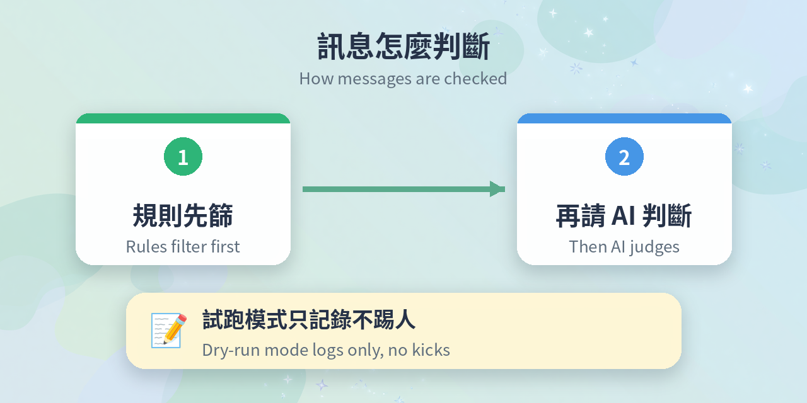
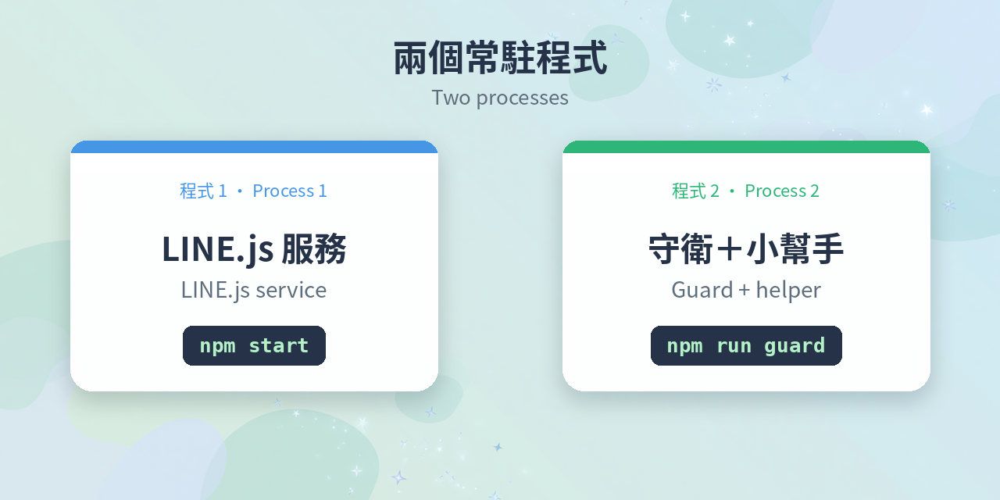
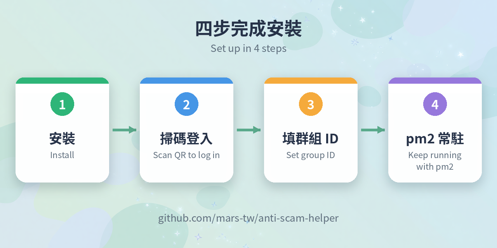

# 群組反詐守門員 新手接線教學｜LINE Group Anti-Scam Gatekeeper Quickstart



> 專案 / Repo：https://github.com/mars-tw/anti-scam-helper
> 中文在前，英文在後。English version follows the Chinese section.

---

## 中文版

### 這是什麼

群裡突然有人說「本群要搬家，請加新群」？或有人把暱稱改得跟群主一模一樣，開始私訊大家？

**群組反詐守門員**就是幫你顧群的：用一個 LINE 小號守在你指定的群組，把這些套路抓出來。它是 [anti-scam-helper](https://github.com/mars-tw/anti-scam-helper) 裡的 `guard/` 程式（LINE.js 非官方網頁用戶端的修改版，Apache-2.0 開源）。

- 🚫 **假搬家、加賴引流、飆股帶單**：規則先篩，再請 AI 判斷「發言的人是不是在行騙」，所以有人問「這連結是詐騙嗎？」比較不會被誤判。沒命中任何規則的訊息預設直接放行、不送模型。
- 👤 **冒名群主／管理員**：社群會自動記住誰是管理員；一般群組在 `protectedMembers` 填名字和本人成員 ID。
- 🔍 **圖片 QR code**：在主機上解讀，圖片不外傳；群組邀請、加好友的 QR 會被處理。
- 💬 **小助手**：範例設定下，訊息開頭打「小助手」或在一般群組 @ 這個帳號就會回答，有每日次數上限，回覆裡的網址只留白名單（預設只有 165 官網）。
- 🧪 **試跑模式 `dryRun`**：範例設定預設開啟，只記錄「會踢誰」，不會真的踢。



AI 可接任一 OpenAI 相容端點（例如 OpenAI、xAI Grok），也能在主機上跑免費的地端小模型。運作時有兩個程序：① LINE.js 服務（`npm start`）；② 守衛＋小助手（`npm run guard`）。跟著下面的步驟，一步一個指令就能接好。



> 💡 開始前：建議用 LINE 小號，先開試跑模式觀察幾天，再決定要不要真的踢人。

### 需要什麼

| 項目 | 說明 |
|---|---|
| 主機 | 一台一直開著的 Linux 主機（VPS 等），磁碟要能保存 `session.json`，不然每次重啟都要重新掃碼 |
| Node.js | **22 以上**，含 npm |
| 網路 | 能連 JSR、npm 和 LINE（`.npmrc` 已設定 JSR registry） |
| LINE 帳號 | 能掃 QR、輸入 PIN 的**次要帳號**（預設以 `ANDROIDSECONDARY` 裝置登入） |
| 語言模型 | **任一 OpenAI 相容 LLM 端點，或主機上自己跑的地端模型**。例如 OpenAI，或 xAI Grok（把 `baseUrl` 改成 Grok 的端點）；免費做法是用 llama.cpp 的 `llama-server` 跑小模型。沒有任何模型時，守衛只靠規則分數判斷，小助手不回覆 |
| 踢人權限 | 社群裡，登入帳號要是管理員或共同管理員；一般群組成員都能移除他人 |

### 步驟



以下在主機的終端機操作。需要兩個終端機視窗：**A 視窗**跑 LINE.js 服務，**B 視窗**下其他指令。

**1. 確認 Node 版本（要 22 以上）**
```sh
node -v
```

**2. 下載程式**
```sh
git clone https://github.com/mars-tw/anti-scam-helper.git
```

**3. 進入資料夾**
```sh
cd anti-scam-helper
```

**4. 安裝主程式套件**
```sh
npm install
```

**5. 建置**
```sh
npm run build
```

**6. 安裝守衛套件（QR 解讀、WebSocket）**
```sh
npm install --prefix guard
```

> 要經代理連 LINE 的話，**一定要在第 8 步登入前**設好：`cp proxy.example.txt proxy.txt`，改成自己的代理，再 `chmod 600 proxy.txt`。登入後不要再拿掉或更換代理。不用代理就跳過。

**7.（A 視窗）啟動 LINE.js 服務**
```sh
npm start
```
第一次啟動會從 `config.example.yaml` 自動建立 `config.yaml`。這個視窗保持開著。

**8.（B 視窗）登入 LINE**
```sh
npm run cli -- login
```
終端機會畫出 QR code。用**次要帳號**的手機 LINE 掃描，手機要求輸入 PIN 時，輸入印在 QR 下方的數字。看到「已登入：…」就完成。最多等 3 分鐘，逾時就重跑這個指令。中間的 `--` 不能省。QR 和 PIN 只顯示在終端機、不會存成檔案，等同登入憑證，不要截圖或轉貼。終端機畫不出 QR 時，改用第 9 步的 SSH 通道開網頁版，按「產生登入 QR code」。

**9. 取得群組或社群 ID**

主機上的網頁版只聽 `127.0.0.1`，所以在**自己的電腦**開一個 SSH 通道，把主機的 3789 埠接過來（本機 3789 被占用就改別的埠）：
```sh
ssh -L 3789:127.0.0.1:3789 <使用者>@<主機>
```
通道開著時，用自己電腦的瀏覽器開 `http://127.0.0.1:3789`，看到的就是主機上那個已登入的服務，不需要在自己電腦另外登入 LINE，也就不會兩地登入。在左側聊天清單對要守護的群組按右鍵 →「顯示頻道 ID」→ 複製。群組 ID 以 `c` 開頭、社群以 `m` 開頭。查完關掉通道即可，3789 埠不要開到公網。

**10. 開啟機器人 API**
```sh
nano config.yaml
```
改成下面這樣（`<群組或社群 ID>` 換成上一步複製的 ID）：
```yaml
server:
  host: 127.0.0.1          # 保持只聽本機
api:
  enabled: true            # 預設 false
  chats:
    - <群組或社群 ID>        # 至少一個；沒列的聊天室機器人看不到
  moderation: true         # 開了才能移除成員、取圖片讀 QR
chat:
  sendReadReceipts: false  # 主機上沒人看網頁，不回已讀
```

**11.（A 視窗）重啟服務讓設定生效**

在 A 視窗按 `Ctrl+C` 停掉，再執行：
```sh
npm start
```

**12.（B 視窗）產生機器人 Token**
```sh
export LINEJS_TOKEN=$(npm run -s cli -- token --yes)
```
Token 只會顯示這一次，伺服器只存雜湊。重新產生會讓舊的立刻失效。

**13. 複製守衛設定範本**

用雲端 API（OpenAI 相容端點）：
```sh
cp guard/guard.config.cloud.example.json guard/guard.config.json
```
或用主機上自己跑的地端模型初篩（範本另有一段雲端 `review` 覆核，不要可以刪掉）：
```sh
cp guard/guard.config.cloud-free.example.json guard/guard.config.json
```

**14. 編輯守衛設定**
```sh
nano guard/guard.config.json
```
- `llm.baseUrl`、`llm.model`、`llm.apiKeyEnv`：換成你要用的模型。例如用 xAI Grok：`baseUrl` 改成 `https://api.x.ai/v1`，`apiKeyEnv` 改成 `XAI_API_KEY`；如果 Grok 回 HTTP 400，加上 `"maxTokensField": "max_tokens"`。
- 地端模型：`apiKeyEnv` 設空字串、`maxTokensField` 設 `max_tokens`，`baseUrl` 指向你的 `llama-server`。
- `review`：只有可疑訊息才送去的第二層覆核模型（規則分數達 `reviewScore`，預設 3）。不想用就把整段 `review` 刪掉。
- `localScreenAll`：範例是 `false`，規則 0 分的訊息直接放行、不送模型；改成 `true` 才連 0 分的也交給 `llm` 判斷（舊名 `checkEveryMessage` 仍有效）。模型端點不在本機時，訊息會先去識別化再送出。
- `chat.facts`、`chat.scope`：改成你們群的規則和小助手能回答的範圍。
- `protectedMembers`：填常被冒名的群主或管理員。
- `chat.dailyTotal`、`chat.dailyPerUser`：小助手每日次數上限，也就是付費 API 的用量上限。
- **`dryRun` 保持 `true`**。

**15. 設定模型金鑰環境變數**（用地端模型就跳過）
```sh
export XAI_API_KEY=<你的金鑰>
```
變數名稱要跟 `apiKeyEnv` 一樣。用 OpenAI 就改成 `OPENAI_API_KEY`。金鑰不要寫進任何檔案或程式碼。

**16.（地端模型才需要）另開一個視窗啟動 llama-server**
```sh
llama-server -m <主模型>.gguf --mmproj <mmproj>.gguf --host 127.0.0.1 --port 8080 -c 8192
```
`--host` 保持 `127.0.0.1`。用 `curl http://127.0.0.1:8080/v1/models` 有回應就代表起來了。

**17.（B 視窗）啟動守衛**
```sh
npm run guard
```
看到「已連線 LINE.js（反詐試跑模式：只記錄、不踢人）…」、「LINE 帳號：…」、「守護中的聊天室：…」就是接好了；社群還會出現「記住管理員：…」。第一行後半會寫出小助手怎麼叫：範例設定是「觸發詞：小助手，或 @ 本帳號」，在群裡發「小助手 你好」試試；試跑模式下小助手不會真的發言，畫面會印「【試跑，未回覆】…」。如果你設了 `chat.mentionOnly: true`，觸發詞就不再有效，只有 @ 本帳號或回覆本帳號的訊息才會回。

**18. 看試跑紀錄**
```sh
ls guard/logs/
```
每個判斷都寫在 `guard/logs/guard-日期.jsonl`，試跑時處置欄位是 `dry-run`；守衛的終端機畫面（改用 pm2 後是 `pm2 logs`）會印「【試跑，未踢】…」。多看幾天，確認誤判少了再考慮把 `dryRun` 改成 `false`。

**19. 改成 pm2 常駐**

先在 A、B 視窗按 `Ctrl+C` 停掉前面手動啟動的服務和守衛，然後在同一個已經 `export` 過 Token 和金鑰的視窗執行：
```sh
npm install -g pm2
```
```sh
pm2 start "npm run guard:all" --name line-guard
```
`guard:all` 會一起看顧 LINE.js 服務和守衛，當掉會自動重啟（5 秒起，最長間隔 5 分鐘）。地端模型也要常駐的話：`pm2 start "llama-server …同上參數" --name llm`。

**20. 存下程序清單並設定開機自動啟動**
```sh
pm2 save && pm2 startup
```
`pm2 startup` 會印出一行要你用 sudo 執行的指令，照著執行。這需要主機有 systemd 之類的開機管理。

### 常見坑

1. **Node 版本不夠**：專案要求 Node 22 以上，有些主機預設是 20。先跑 `node -v`。
2. **`--` 和 `--yes`**：`npm run cli -- login` 的 `--` 不能省；在腳本這類非互動環境產生 Token 要加 `--yes`。
3. **代理要在登入前決定**：登入後拿掉或更換代理、或代理商換了出口 IP，LINE 可能要求重新登入或限制帳號。
4. **同一帳號不要兩地登入**：自己電腦和雲端主機同時跑 LINE.js 登同一帳號，可能互相登出。
5. **手機上把裝置登出了**：要重新跑 `npm run cli -- login` 掃碼，守衛畫面會提示。
6. **社群裡 @ 沒反應**：社群裡被 @ 的是每個社群各自的成員 ID，跟帳號 ID 不同，所以社群請用觸發詞（例如「小助手 …」）。
7. **自家群的 QR 被擋**：自己正式的 QR code 要列進 `qr.allow`。
8. **沒發言的管理員認不到**：社群管理員是從帶管理員身分的訊息學來的（啟動時讀最近 100 則＋之後的新訊息），很少發言的管理員要手動填進 `protectedMembers`。
9. **社群踢不了人**：回「無法移除這位成員」代表登入帳號不是管理員或共同管理員。
10. **Token 錯或 api 沒開**：守衛會印「機器人 API 拒絕連線（HTTP …）」，回頭檢查第 10、12 步。完全沒給 Token 會印「缺少機器人 Token」。
11. **模型金鑰變數沒設**：日誌出現「模型無法使用（…）：缺少環境變數 …」，檢查第 15 步的變數名稱是否和 `apiKeyEnv` 一致。
12. **小模型看圖會誤判**：看圖功能 `vision` 在雲端範本預設關閉、地端範本預設開啟，兩者都是 `action: "report"`（只記錄）；不要直接設成 `remove`。看圖通知用的 `vision.alertChatId` 也要列在 `api.chats`。

### 安全提醒

- **`3789` 埠不要開到公網**：網頁沒有帳號密碼，連得到的人就能操作這個 LINE 帳號。`config.yaml` 的 `server.host` 和 `llama-server --host` 都保持 `127.0.0.1`。
- **秘密不進 git**：`session.json`、`api-token.json`、`config.yaml`、`proxy.txt`、`guard/guard.config.json`、`guard/token.txt`、`guard/logs/`、`data/` 都已在 `.gitignore`。金鑰和 Token 用環境變數或平台的 Secret 設定，不要寫進程式。
- **檔案權限 600**：`session.json` 含 LINE 憑證和加密金鑰，`chmod 600 session.json`；`proxy.txt` 同樣處理。
- **紀錄只留在主機**：`guard/logs/` 不記訊息文字（只有短雜湊和字數），但有成員 ID、暱稱和判定結果，不要上傳或分享。
- **聊天學習資料預設關閉**：`chat.training.enabled` 預設不開；打開會把去識別化後的聊天內容寫進硬碟，啟動時會警告。
- **小助手是用你的帳號說話**：群組成員看到的是登入的那個 LINE 帳號在回覆。
- **踢人先試跑**：`dryRun: true` 觀察幾天；改成 `false` 前要知道，真實踢人的效果目前還沒有驗證紀錄，誤判的後果由使用者自負。

---

## English

### What it is

Someone in your group posts "We've moved, join the new group here"? Or copies the admin's name and starts DMing members?

The **LINE Group Anti-Scam Gatekeeper** keeps watch for you: one spare LINE account sits in the groups you choose and catches these tricks. It's the `guard/` program in [anti-scam-helper](https://github.com/mars-tw/anti-scam-helper) (a modified LINE.js, an unofficial LINE web client; open source under Apache-2.0).

- 🚫 **Fake group moves, "add my LINE", stock-tip bait**: rules flag them first, then an AI model decides whether *the sender* is scamming, so someone asking "is this link a scam?" is less likely to be misjudged. By default, messages that hit no rule pass straight through without going to a model.
- 👤 **Admin impersonation**: in communities it remembers who the admins are; in regular groups you list names and real member IDs in `protectedMembers`.
- 🔍 **QR codes in images**: decoded on the host, images never leave it; group-invite and add-friend QR codes are acted on.
- 💬 **Helper bot**: with the example configs, start a message with 「小助手」 (or @-mention the account in a regular group) and it answers, with daily limits; links in replies are kept only for allow-listed domains (by default Taiwan's 165 anti-fraud site).
- 🧪 **Dry-run mode (`dryRun`)**: on by default in the example configs; it only logs who *would* be removed.


Use any OpenAI-compatible endpoint (e.g. OpenAI, xAI Grok) or a free local model on the host. Two processes run: (1) the LINE.js service (`npm start`) and (2) the guard + helper (`npm run guard`). Follow the steps below, one command at a time.


> 💡 Before you start: use a spare LINE account and run in dry-run mode for a few days before turning on real removals.

### Requirements

| Item | Notes |
|---|---|
| Host | An always-on Linux host (e.g. a VPS) with persistent disk for `session.json`, otherwise you re-scan the QR after every restart |
| Node.js | **22 or newer**, with npm |
| Network | Access to JSR, npm and LINE (`.npmrc` already points to the JSR registry) |
| LINE account | A **secondary account** that can scan a QR code and confirm a PIN (logs in as an `ANDROIDSECONDARY` device by default) |
| Language model | **Any OpenAI-compatible LLM endpoint, or a local model on the host.** For example OpenAI, or xAI Grok by changing `baseUrl`; the free option is a small model under llama.cpp's `llama-server`. With no model, the guard uses rule scores only and the helper does not reply |
| Removal rights | In communities the account must be an admin or co-admin; in regular groups any member can remove others |

### Steps


Run these on the host. Use two terminals: **Terminal A** for the LINE.js service, **Terminal B** for everything else.

**1. Check Node (22+)**
```sh
node -v
```

**2. Clone**
```sh
git clone https://github.com/mars-tw/anti-scam-helper.git
```

**3. Enter the folder**
```sh
cd anti-scam-helper
```

**4. Install dependencies**
```sh
npm install
```

**5. Build**
```sh
npm run build
```

**6. Install guard dependencies (QR decoding, WebSocket)**
```sh
npm install --prefix guard
```

> If you need a proxy to reach LINE, set it up **before logging in at step 8**: `cp proxy.example.txt proxy.txt`, edit it, then `chmod 600 proxy.txt`. Don't remove or change the proxy after login. Skip this if you connect directly.

**7. (Terminal A) Start the LINE.js service**
```sh
npm start
```
The first start creates `config.yaml` from `config.example.yaml`. Leave this running.

**8. (Terminal B) Log in to LINE**
```sh
npm run cli -- login
```
A QR code is drawn in the terminal. Scan it with LINE on the **secondary account's** phone, then enter the PIN printed under the QR when the phone asks. "已登入：…" means you're in. It waits up to 3 minutes; rerun on timeout. Keep the `--`. The QR code and PIN are shown only in the terminal and never saved to a file; treat them like a password and don't screenshot or share them. If your terminal can't draw the QR, open the web UI through the SSH tunnel in step 9 and press 「產生登入 QR code」 (generate login QR).

**9. Get the group or community ID**

The web UI on the host listens on `127.0.0.1` only, so open an SSH tunnel **from your own computer** (pick another local port if 3789 is taken):
```sh
ssh -L 3789:127.0.0.1:3789 <user>@<host>
```
While the tunnel is open, browse to `http://127.0.0.1:3789` on your computer. You're looking at the host's already-logged-in service, so there's no second LINE login on your PC. Right-click the chat in the left list → 「顯示頻道 ID」 (show channel ID) → copy. Group IDs start with `c`, community IDs with `m`. Close the tunnel when done; never expose port 3789 publicly.

**10. Enable the bot API**
```sh
nano config.yaml
```
Set (replace `<chat ID>` with the ID from step 9):
```yaml
server:
  host: 127.0.0.1          # keep it local-only
api:
  enabled: true            # default false
  chats:
    - <chat ID>            # at least one; unlisted chats are invisible to bots
  moderation: true         # required to remove members and fetch images for QR
chat:
  sendReadReceipts: false  # nobody reads the web UI on a server
```

**11. (Terminal A) Restart the service**

Press `Ctrl+C`, then:
```sh
npm start
```

**12. (Terminal B) Create the bot token**
```sh
export LINEJS_TOKEN=$(npm run -s cli -- token --yes)
```
The token is shown only once; the server stores only a hash. Regenerating revokes the old one.

**13. Copy a guard config template**

Cloud API (OpenAI-compatible endpoint):
```sh
cp guard/guard.config.cloud.example.json guard/guard.config.json
```
Or a local model on the host for the first pass (this template also has a cloud `review` block; delete it if you don't want one):
```sh
cp guard/guard.config.cloud-free.example.json guard/guard.config.json
```

**14. Edit the guard config**
```sh
nano guard/guard.config.json
```
- `llm.baseUrl`, `llm.model`, `llm.apiKeyEnv`: point them at your model. For xAI Grok, set `baseUrl` to `https://api.x.ai/v1` and `apiKeyEnv` to `XAI_API_KEY`; if Grok returns HTTP 400, add `"maxTokensField": "max_tokens"`.
- Local model: set `apiKeyEnv` to an empty string, `maxTokensField` to `max_tokens`, and `baseUrl` to your `llama-server`.
- `review`: a second-pass model that only sees suspicious messages (rule score ≥ `reviewScore`, default 3). Delete the whole `review` block if you don't want it.
- `localScreenAll`: `false` in the examples, so messages scoring 0 on the rules pass without a model call; set `true` to send those to `llm` too (the old name `checkEveryMessage` still works). If a model endpoint isn't local, messages are de-identified before they're sent.
- `chat.facts`, `chat.scope`: your group's rules and what the helper may answer.
- `protectedMembers`: the owner/admin names scammers tend to copy.
- `chat.dailyTotal`, `chat.dailyPerUser`: daily helper limits, which also cap paid API usage.
- **Keep `dryRun: true`.**

**15. Set the model key variable** (skip for a local model)
```sh
export XAI_API_KEY=<your key>
```
The name must match `apiKeyEnv` (use `OPENAI_API_KEY` for OpenAI). Never put keys in files or code.

**16. (Local model only) Start llama-server in another terminal**
```sh
llama-server -m <model>.gguf --mmproj <mmproj>.gguf --host 127.0.0.1 --port 8080 -c 8192
```
Keep `--host 127.0.0.1`. `curl http://127.0.0.1:8080/v1/models` responding means it's up.

**17. (Terminal B) Start the guard**
```sh
npm run guard
```
You should see 「已連線 LINE.js（反詐試跑模式：只記錄、不踢人）…」 (connected, dry-run: log only), 「LINE 帳號：…」 (account) and 「守護中的聊天室：…」 (guarded chats); communities also show 「記住管理員：…」 (admins learned). The end of the first line tells you how to call the helper: with the example configs it's 「觸發詞：小助手，或 @ 本帳號」 (trigger word 小助手, or @ this account). Try posting 「小助手 你好」; in dry-run the helper doesn't actually post and the console prints 「【試跑，未回覆】…」 (dry run, not replied). If you set `chat.mentionOnly: true`, trigger words stop working and it only answers @-mentions of the account or replies to its messages.

**18. Review the dry-run log**
```sh
ls guard/logs/
```
Every decision goes to `guard/logs/guard-<date>.jsonl`, with action `dry-run` in dry-run mode; the guard's console (`pm2 logs` once you use pm2) prints 「【試跑，未踢】…」 (dry run, not removed). Watch it for several days before considering `dryRun: false`.

**19. Keep it running with pm2**

Stop the manual service and guard with `Ctrl+C` in both terminals. Then, in a terminal where the token and key are already exported:
```sh
npm install -g pm2
```
```sh
pm2 start "npm run guard:all" --name line-guard
```
`guard:all` supervises both the LINE.js service and the guard, restarting them on crash (5 s back-off, up to 5 min). For a local model: `pm2 start "llama-server …same args" --name llm`.

**20. Save and enable start on boot**
```sh
pm2 save && pm2 startup
```
`pm2 startup` prints a sudo command; run it. This needs a boot manager such as systemd on the host.

### Common pitfalls

1. **Old Node**: Node 22+ is required; some hosts default to 20. Check `node -v`.
2. **`--` and `--yes`**: keep the `--` in `npm run cli -- login`; add `--yes` when generating the token non-interactively.
3. **Decide on a proxy before login**: removing or switching it later, or the provider rotating exit IPs, may force a re-login or get the account restricted.
4. **Don't log in from two places**: running LINE.js on your PC and the server with the same account may log both out.
5. **Device logged out on the phone**: rerun `npm run cli -- login`; the guard will tell you.
6. **@mentions don't trigger in communities**: communities mention a per-community member ID, not the account ID. Use the trigger word instead.
7. **Your own QR gets flagged**: add your official QR codes to `qr.allow`.
8. **Silent admins aren't recognized**: community admins are learned from their messages (last 100 at start, then new ones). Add rarely-posting admins to `protectedMembers` manually.
9. **Can't remove in a community**: 「無法移除這位成員」 means the account isn't an admin or co-admin.
10. **Bad token or API off**: the guard prints 「機器人 API 拒絕連線（HTTP …）」; recheck steps 10 and 12. No token at all prints 「缺少機器人 Token」.
11. **Model key variable missing**: the log shows 「模型無法使用（…）：缺少環境變數 …」; make sure the variable name matches `apiKeyEnv`.
12. **Small vision models misjudge**: `vision` is off in the cloud template and on in the local template, both with `action: "report"` (log only). Don't jump straight to `remove`. A `vision.alertChatId` must also be listed in `api.chats`.

### Security notes

- **Never expose port 3789**: the web UI has no login; anyone who reaches it controls the LINE account. Keep `server.host` and `llama-server --host` at `127.0.0.1`.
- **Secrets stay out of git**: `session.json`, `api-token.json`, `config.yaml`, `proxy.txt`, `guard/guard.config.json`, `guard/token.txt`, `guard/logs/` and `data/` are all in `.gitignore`. Pass keys and tokens via environment variables or your platform's secrets.
- **Permissions 600**: `session.json` holds LINE credentials and encryption keys; `chmod 600 session.json`, same for `proxy.txt`.
- **Logs stay on the host**: `guard/logs/` doesn't store message text (only a short hash and length), but it does hold member IDs, nicknames and verdicts. Don't upload or share it.
- **Chat training data is off by default**: `chat.training.enabled` is off; turning it on writes de-identified chat content to disk, and the guard warns at startup.
- **The helper speaks as you**: members see the logged-in account replying.
- **Dry-run before removals**: watch with `dryRun: true` for several days. Real removals have no verified track record yet, and misfires are the operator's responsibility.
